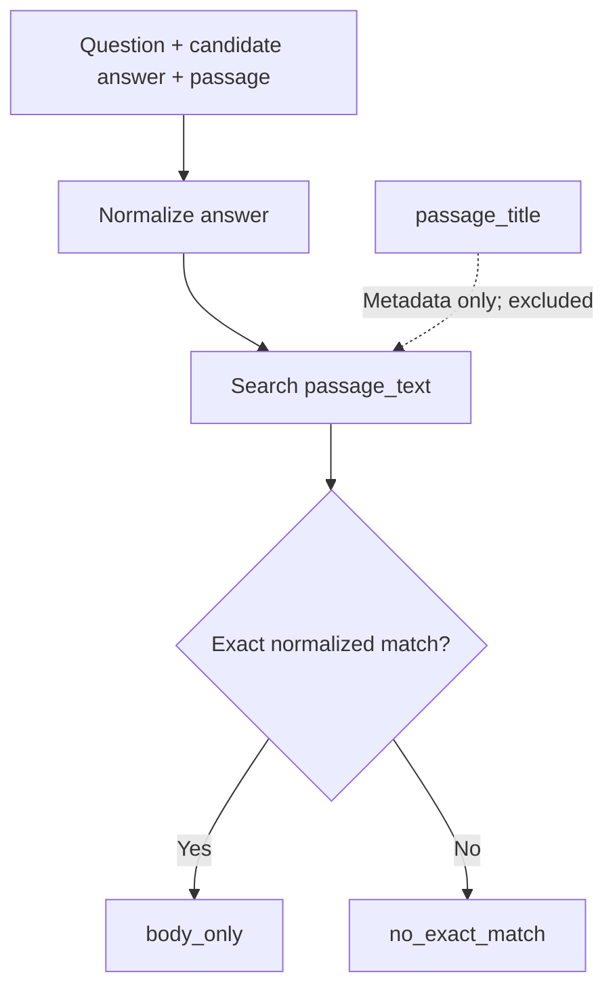
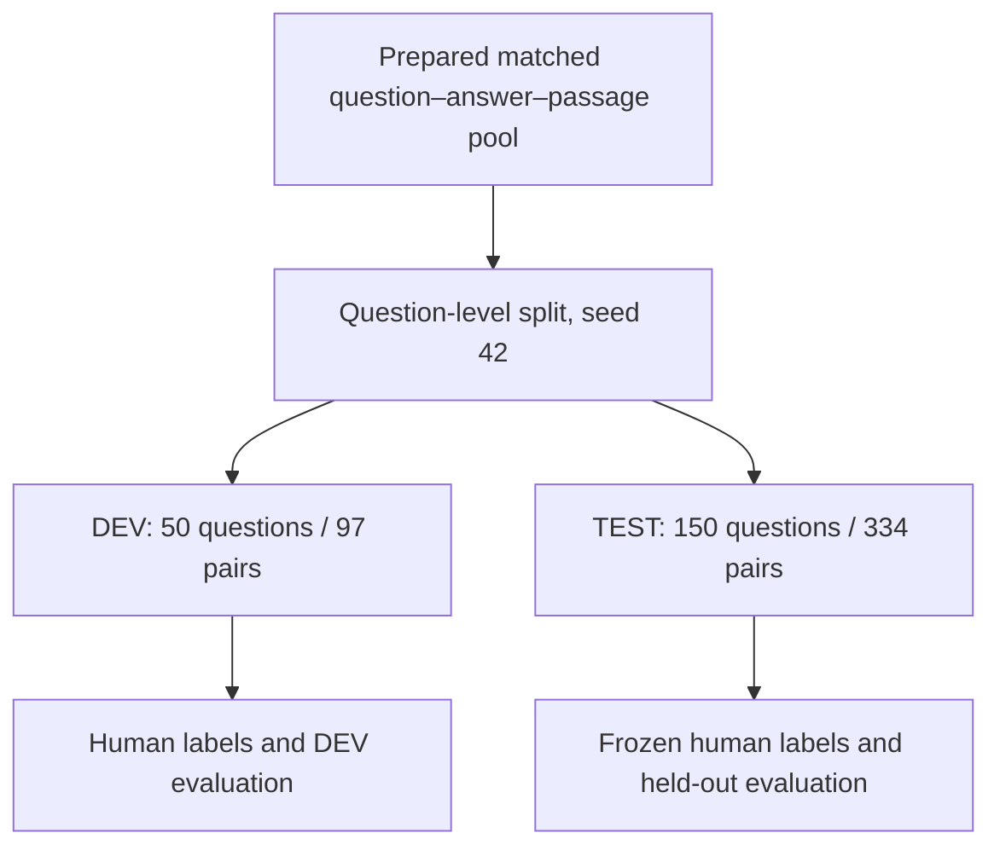
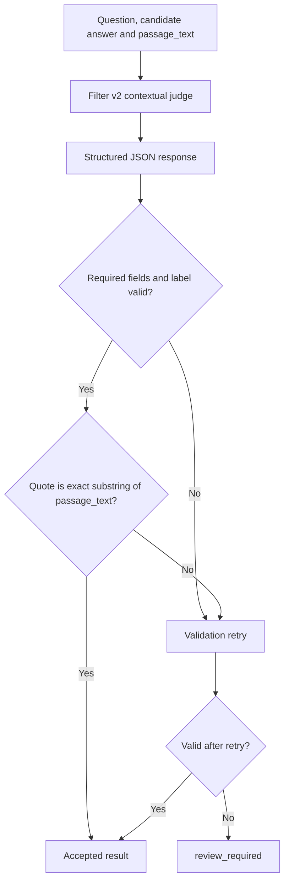

# Dataset Preparation and Filter v1–v2 Evaluation

**Project:** Security-Aware Context Screening and Evidence Selection for RAG Systems  
*Defending Against Indirect Prompt Injection and Knowledge Poisoning*

**Phase:** Dataset Preparation and Contextual Evaluation  

---

## 1. Purpose of this stage

The purpose of this stage was to prepare a reliable, human-labelled dataset, document the earlier **Filter v1** approach, and evaluate **Filter v2**, a contextual judge that classifies how a passage relates to a question and a candidate answer.

A simple string match cannot tell us whether a passage genuinely supports an answer. The answer phrase might appear directly, be expressed through different wording, be only partly supported, occur incidentally, or be contradicted. We therefore needed a dataset that allowed these different evidence relationships to be examined and measured.

This work developed in stages:

1. **Initial filtering with Filter v1:** use normalized answer-string containment to decide whether a question had a matching answer in its relevant passage bodies.
2. **Expanded dataset preparation:** connect questions, answer variants, and relevant passages; validate the data; and create frozen DEV and TEST sets.
3. **Filter v2 evaluation:** obtain human evidence labels, run the contextual judge, validate its responses, and compare its classifications with the human labels.

The intention was to establish a measured baseline for contextual evidence classification—not merely to check whether an answer string appeared in a passage.

---

## 2. Datasets used

We used two Natural Questions resources because they provide different information.

| Dataset | Information used | Role |
|---|---|---|
| **BEIR Natural Questions (NQ)** | Questions, Wikipedia passage corpus, and relevance qrels | Supplied questions, candidate passages, and relevant passage IDs |
| **NQ Open** | Questions and short answer strings, including answer variants | Supplied candidate answers associated with questions |

The datasets were connected through normalized question text. We did not assume that their record IDs or row ordering were interchangeable.

### Initial counts

| Item | Count |
|---|---:|
| BEIR NQ questions | 3,452 |
| NQ Open examples | 3,610 |
| Matched questions | 2,255 |
| Unmatched BEIR NQ questions | 1,197 |
| Duplicate normalized NQ Open questions | 0 |

**Why this step mattered:** BEIR NQ gives us retrieval relevance information, while NQ Open gives us answer strings. Matching their questions allowed us to connect candidate answers to relevant passages.

---

## 3. Matching questions and checking qrels

### 3.1 Question matching

Question text was normalized before matching. This made it possible to match equivalent question strings consistently despite superficial formatting differences.

Of the 3,452 BEIR NQ questions, 2,255 matched NQ Open questions. The other 1,197 had no match under this procedure and were excluded from the matched question pool.

### 3.2 Relevant passages from qrels

BEIR's **qrels** (relevance judgments) identify which corpus passages are relevant to each question. We used positive qrels to obtain relevant passage IDs for the matched questions, then checked that those IDs existed in the BEIR corpus.

| Validation check | Result |
|---|---:|
| Matched questions with positive qrels | 2,255 |
| Matched questions without positive qrels | 0 |
| Unique relevant passage IDs | 2,816 |
| Relevant passage IDs found in corpus | 2,816 |
| Positive qrels rows | 4,201 |
| Duplicate question–passage qrels pairs | 0 |
| Corpus records streamed during inspection | 2,681,468 |
| Duplicate corpus IDs found | 0 |

The corpus was inspected by streaming records rather than loading all records into memory at once.

**Why this mattered:** it confirmed that every unique relevant passage ID identified by qrels was available in the corpus and could be used in the evaluation data.

---

## 4. Creating answer–passage evaluation pairs

NQ Open contains short answers and can provide multiple answer variants for a question. We associated those answer variants with relevant passages identified through BEIR NQ.

The resulting preparation produced:

| Item | Count |
|---|---:|
| Answer variants | 3,916 |
| Evaluation pairs | 5,079 |

An **evaluation pair** represents a candidate answer considered in relation to a question and a passage. One question can contribute multiple pairs because it may have multiple answer variants and/or relevant passages.

At this point, we had candidate question–answer–passage combinations. We still needed to check answer-string occurrences and then distinguish literal matches from actual evidence support.

### 4.1 Earlier approach: Filter v1

Before Filter v2, we used **Filter v1** as a simpler, deterministic filtering method. Its job was to identify questions for which at least one candidate answer string could be found in the body text of at least one qrels-positive passage.

Filter v1 worked as follows:

1. Take a matched question and its candidate answer variant(s).
2. Consider the question's relevant passages identified through positive qrels.
3. Normalize the answer and passage text using Unicode NFKC normalization, case folding, and punctuation removal (punctuation was converted to spaces).
4. Check whether any normalized answer variant was contained in any relevant passage body.
5. Accept the question if at least one such containment match was found; otherwise reject it.

| Filter v1 outcome | Questions |
|---|---:|
| Accepted | 2,214 |
| Rejected | 41 |
| **Total matched questions checked** | **2,255** |

Filter v1 therefore acted as a **binary, question-level filter**. It retained questions with at least one literal normalized answer occurrence in a relevant passage body. Its output preserved the relevant passage IDs and the passage IDs where a match was found; rejected questions were omitted from that output.

**What Filter v1 could not tell us:** it did not determine whether the occurrence actually supported the answer in context. It did not distinguish a direct answer from a partial answer, a semantic match, an incidental mention, or a contradiction. It also did not evaluate each answer–passage pair with a contextual evidence label. A string could be present without being useful evidence.

### Filter v1 compared with Filter v2

| Aspect | Filter v1 | Filter v2 |
|---|---|---|
| Main purpose | Quickly retain questions with an answer-string occurrence | Judge the evidence relationship between a question, candidate answer, and passage |
| Decision level | Binary, question-level: accepted or rejected | Pair-level contextual classification |
| Main method | Deterministic normalized string containment | Contextual LLM judge, supported by deterministic matching and response validation |
| Evidence considered | Relevant passage bodies; answer variants checked for containment | Full `passage_text` considered as context; `passage_title` remains metadata only |
| Output | Accepted questions with relevant/matched passage IDs; rejected questions omitted | One of seven evidence labels, plus an evidence quote and rationale; invalid outputs can become `review_required` |
| Can identify partial or semantic support? | No | Explicitly represented by `partial_support` and `semantic_support` labels |
| Can distinguish incidental mention or contradiction? | No | Explicitly represented by `incidental_match` and `contradictory` labels |
| Main limitation | Presence of a string is treated as the filtering signal, not proof of support | Contextual judgement can still be wrong; its classifications must be evaluated against human labels |

The key change from v1 to v2 was not simply a more flexible string matcher. **Filter v1 asked, “Does an answer string occur in any relevant passage?” Filter v2 asked, “What does this passage actually establish about this candidate answer?”** Filter v1 remains useful as the historical exact-containment baseline, but its binary output is not interchangeable with the seven-way labels produced by v2.

---

## 5. Deterministic answer matching — body only

We implemented a deterministic matcher to check whether a normalized answer string appeared in the passage body.

The evidence policy was explicitly set as follows:

- `passage_text` is the evidence unit.
- `passage_title` is metadata only.
- A title match does not count as evidence.
- Titles are excluded from contextual judging and evidence-quote validation.

### Results

| Matcher result | Meaning | Pairs |
|---|---|---:|
| `body_only` | Exact normalized answer string found in `passage_text` | 4,007 |
| `no_exact_match` | No exact normalized answer string found in `passage_text` | 1,072 |
| **Total** | | **5,079** |



The matcher found a body occurrence for 4,007 pairs and no exact body occurrence for 1,072 pairs.

**Why body-only mattered:** a passage title can contain an answer phrase even when the passage body does not explain or support it. Restricting evidence to the body made the evidence source consistent.

**Limitation:** exact matching can miss paraphrases, aliases, and equivalent meanings. It can also find an answer phrase in an unrelated context. It is therefore a deterministic first-pass signal, not proof that the passage supports the answer. Filter v2 performs a separate contextual classification.

---

## 6. Creating the golden DEV and TEST sets

We selected a smaller set for human annotation and contextual evaluation. The split was performed at the **question level**, using seed `42`. All pairs belonging to a selected question remained in the same split.

| Split | Unique questions | Evaluation pairs |
|---|---:|---:|
| DEV | 50 | 97 |
| TEST | 150 | 334 |
| **Total** | **200** | **431** |

The split check found no question overlap between DEV and TEST. The remaining pool contained 2,055 unused questions and 4,648 unused pairs.

### Why two sets?

- **DEV** was used for contextual-judge evaluation and inspection.
- **TEST** was kept separate as the held-out evaluation set. Its human labels were frozen and were not used to tune the model.

This separation reduces the risk of evaluating a model on examples that were repeatedly used to make development decisions.



---

## 7. Human annotation

### 7.1 Why human labels were needed

The deterministic matcher tells us whether an answer string appears in the passage body. It cannot reliably determine whether the passage directly supports the answer, supports it only partly, expresses the same meaning, mentions it incidentally, or contradicts it.

Human annotations supplied the reference labels used to evaluate Filter v2.

### 7.2 Evidence classification labels

| Label | User-friendly meaning |
|---|---|
| `direct_support` | The passage clearly and directly supports the candidate answer. |
| `semantic_support` | The passage supports the answer by meaning, even if the wording differs. |
| `partial_support` | The passage supports only part of the answer or gives incomplete evidence. |
| `incidental_match` | The answer phrase appears, but only incidentally; the passage does not meaningfully support it. |
| `contradictory` | The passage conflicts with the candidate answer. |
| `no_support` | The passage does not provide evidence for the candidate answer. |
| `ambiguous` | The evidence is unclear or insufficient to confidently assign another label. |

The central distinction is that **answer-string presence is not the same as evidence support**.

### 7.3 Human label distribution

The `final_label` field was used as the authoritative human label.

**DEV — 97 pairs**

| Human label | Count |
|---|---:|
| `direct_support` | 54 |
| `partial_support` | 20 |
| `semantic_support` | 14 |
| `no_support` | 6 |
| `incidental_match` | 2 |
| `contradictory` | 1 |
| `ambiguous` | 0 |
| **Total** | **97** |

**TEST — 334 pairs**

| Human label | Count |
|---|---:|
| `direct_support` | 179 |
| `partial_support` | 66 |
| `semantic_support` | 38 |
| `no_support` | 40 |
| `incidental_match` | 8 |
| `contradictory` | 3 |
| `ambiguous` | 0 |
| **Total** | **334** |

The sets are class-imbalanced: direct support is the largest class, while incidental match and contradictory are rare. This is why class-wise metrics and confusion matrices are important alongside overall accuracy.

### 7.4 Annotation integrity checks

| Check | DEV | TEST |
|---|---:|---:|
| Annotation records | 97 | 334 |
| Unique pair IDs | 97 | 334 |
| Duplicate pair IDs | 0 | 0 |
| Missing required fields | 0 | 0 |
| `classification` agrees with `final_label` | 95/97 | 334/334 |

There were two disagreements between the original `classification` field and `final_label` in DEV. We used `final_label` as the evaluation ground truth. In TEST, both fields agreed for all 334 records.

The available annotation records do not establish independent multi-annotator agreement or blinded annotation, so no inter-annotator reliability claim is made here.

---

## 8. Filter v2 contextual judge

### 8.1 Intention

Filter v2 was designed to assess the relationship between the question, candidate answer, and passage body. Instead of relying only on literal answer-string presence, it returns one of the seven evidence classifications.

Passage content is treated as **untrusted input**. Any instructions written inside a passage are content to be evaluated, not instructions that the judge should obey.

### 8.2 Evidence and response rules

The evaluation used these rules:

1. Only `passage_text` could be used as evidence.
2. `passage_title` was metadata only.
3. The judge had to return structured JSON.
4. The response had to include `classification`, `evidence_quote`, and `rationale`.
5. The classification had to be one of the seven allowed labels.
6. The evidence quote had to be an exact substring of `passage_text`.
7. The rationale had to be non-empty.

### 8.3 Response validation

A response was accepted only if it passed the required structure, label, and evidence-quote checks. The configured validation retry was attempted for invalid responses. If the response still failed validation, it was marked `review_required`.



The exact-quote rule makes accepted evidence traceable to the original passage. It is strict: a paraphrase, inserted ellipsis, or changed character can fail even when the intended meaning seems reasonable.

---

## 9. Providers and evaluation configuration

Two providers were used during DEV evaluation. Gemini was used for TEST.

| Run | Provider | Model | Dataset |
|---|---|---|---|
| DEV comparison | Groq | `openai/gpt-oss-20b` | 97 DEV pairs |
| DEV evaluation | Gemini | `gemini-3.1-flash-lite` | 97 DEV pairs |
| TEST evaluation | Gemini | `gemini-3.1-flash-lite` | 334 TEST pairs |

The Gemini configuration used:

| Setting | Value |
|---|---|
| Provider | `gemini` |
| Model | `gemini-3.1-flash-lite` |
| Temperature | `0` |
| Response format | JSON |
| Prompt version | `filter_v2_judge_v2` |
| Validation retries | 1 |
| API retries | 3 |
| Request pacing | Enabled |
| Minimum interval between requests | 2 seconds |
| Timeout | 60 seconds |

The Groq DEV run used the same prompt version and general evaluation settings, with its own provider and model configuration.

### Run manifests and resume

Each evaluation output had a sidecar manifest:

```text
<evaluation_output>.jsonl.manifest.json
```

The manifest recorded the provider, model, endpoint, relevant settings, input paths, and SHA-256 hashes of the pair and deterministic-match files.

The resume behavior was exercised during DEV. The first Gemini DEV run had one API error. A later `--resume` run validated the manifest, selected the unfinished pair, and reported success for that pair.

---

## 10. Evaluation results

### 10.1 Execution results

These figures describe the execution status of each run.

| Run | Total pairs | Successful | API errors | `review_required` | Runner errors |
|---|---:|---:|---:|---:|---:|
| DEV Groq | 97 | 91 | 6 | 0 | 0 |
| DEV Gemini — final terminal result | 97 | 97 | 0 | 0 | 0 |
| TEST Gemini | 334 | 327 | 0 | 7 | 0 |

**DEV Gemini artifact note:** the uploaded DEV Gemini JSONL used for the calculations below is an earlier copy containing 96 successes and one API error. The later terminal output confirms that the resume run successfully processed the remaining pair, giving 97 successful evaluations. The updated post-resume JSONL was not included in the uploaded files used for these calculations. Therefore, the DEV Gemini agreement metrics below use the 96 successful records in the available JSONL.

### 10.2 Agreement with human labels

The model's classification was compared with the human `final_label`.

- **Exact agreement / accuracy:** the percentage of accepted model predictions that exactly match the human label.
- **Cohen's kappa:** agreement adjusted for agreement expected by chance.
- **Macro F1:** gives every class equal weight.
- **Weighted F1:** gives more weight to classes with more examples.

Only accepted classifications are included in these classification metrics. API errors and `review_required` records are reported separately.

| Metric | DEV Groq | DEV Gemini* | TEST Gemini |
|---|---:|---:|---:|
| Valid predictions | 91 | 96 | 327 |
| Exact agreement | 54.95% | 53.13% | **66.06%** |
| Cohen's kappa | 0.242 | 0.246 | **0.455** |
| Macro F1 | 0.280 | 0.288 | 0.361 |
| Weighted F1 | 0.509 | 0.503 | 0.625 |
| Coverage of split | 93.81% | 98.97% | 97.90% |

\*DEV Gemini metrics use the earlier uploaded 96-success JSONL, not the later 97-success terminal state.

### 10.3 Exact agreement comparison


TEST Gemini agreement is higher than the observed DEV agreement figures. However, DEV and TEST have different class distributions. Groq was not run on TEST, so these results do not establish that Gemini is better than Groq on unseen data.

### 10.4 TEST per-class performance

These metrics cover the 327 TEST records with accepted classifications.

| Human class | Precision | Recall | F1 | Support |
|---|---:|---:|---:|---:|
| `direct_support` | 77.04% | 86.29% | 81.40% | 175 |
| `partial_support` | 54.55% | 37.50% | 44.44% | 64 |
| `semantic_support` | 55.56% | 13.16% | 21.28% | 38 |
| `no_support` | 47.89% | 85.00% | 61.26% | 40 |
| `incidental_match` | 0.00% | 0.00% | 0.00% | 8 |
| `contradictory` | 28.57% | 100.00% | 44.44% | 2 |

There were no human-labelled `ambiguous` examples among the valid TEST records, so its performance could not be measured. The contradictory class has only two valid examples; its 100% recall should not be treated as stable evidence of performance.

### 10.5 TEST confusion matrix

Rows are human labels and columns are Gemini predictions. Counts cover the 327 accepted classifications.

| Human ↓ / Gemini → | Direct | Partial | Semantic | No support | Incidental | Contradictory |
|---|---:|---:|---:|---:|---:|---:|
| Direct support | 151 | 17 | 2 | 5 | 0 | 0 |
| Partial support | 16 | 24 | 1 | 23 | 0 | 0 |
| Semantic support | 27 | 3 | 5 | 1 | 0 | 2 |
| No support | 2 | 0 | 1 | 34 | 0 | 3 |
| Incidental match | 0 | 0 | 0 | 8 | 0 | 0 |
| Contradictory | 0 | 0 | 0 | 0 | 0 | 2 |

The main errors involved the more nuanced evidence classes:

- 27 human-labelled semantic-support examples were predicted as direct support.
- 23 partial-support examples were predicted as no support.
- All eight incidental-match examples were predicted as no support.

### 10.6 Groq and Gemini on the same DEV examples

For a fair provider comparison, we considered only pair IDs for which both models produced valid predictions.

| Measure | Groq | Gemini |
|---|---:|---:|
| Shared valid pairs | 90 | 90 |
| Exact agreement | 55.56% | 53.33% |
| Cohen's kappa | 0.249 | 0.239 |

The two models agreed with each other on 65 of the 90 shared predictions (72.22%). Their DEV results were similar; this comparison does not show a meaningful advantage for either provider.

---

## 11. Operational observations and validation failures

### 11.1 Rate limits and retries

During the Gemini TEST run, the request log recorded rate-limit responses and other retry events. The configured two-second request pacing did not prevent every rate-limit response. Retry/backoff handling allowed the evaluation to continue, and the final run completed all 334 pairs with zero final API errors.

### 11.2 Seven TEST records requiring review

| Outcome | Count |
|---|---:|
| Accepted classifications | 327 |
| `review_required` | 7 |
| Final API errors | 0 |
| Runner errors | 0 |

The seven review-required responses failed exact evidence-quote validation after the allowed validation retry. Some returned quotes contained ellipses or character/spacing variations that did not appear as one exact substring in the original `passage_text`.

These are **response-validation failures**, not API failures. They were kept separate from the classification metrics.

---

## 12. Chronological summary of completed work

| Order | Work completed | Recorded result |
|---:|---|---|
| 1 | Obtained BEIR NQ and NQ Open | Questions, corpus, qrels, and answer strings available |
| 2 | Matched question text across datasets | 2,255 matched questions |
| 3 | Checked qrels and passage availability | All 2,816 unique relevant passage IDs found |
| 4 | Applied the earlier Filter v1 method | 2,214 accepted questions; 41 rejected |
| 5 | Associated answer variants with relevant passages | 5,079 evaluation pairs |
| 6 | Ran deterministic matching on passage bodies only | 4,007 matches; 1,072 no exact matches |
| 7 | Selected golden DEV and TEST sets | 97 DEV pairs; 334 TEST pairs |
| 8 | Obtained and checked human annotations | Frozen `final_label` reference labels |
| 9 | Implemented Filter v2 contextual judging and validation | Seven-label structured evaluation |
| 10 | Evaluated Groq and Gemini on DEV | Provider comparison against human labels |
| 11 | Evaluated Gemini on TEST | 327 accepted classifications; 7 review-required |

## 13. Overall interpretation

This stage documented the progression from Filter v1's binary answer-string filtering to Filter v2's contextual evidence classification. It prepared the question–answer–passage evaluation data, established a body-only evidence policy, obtained human reference labels, and measured Filter v2's contextual classifications against those labels.

The results show that the judge handled direct-support and no-support examples more reliably than nuanced categories such as semantic support, partial support, and incidental match. The strict quote validator also rejected seven TEST responses that did not provide an exact passage substring.

**In short:** Filter v1 established a simple exact-containment baseline, while Filter v2 moved the task toward judging evidence meaning and quality in context. The intention of this stage was to create a structured, human-labelled dataset and measure how well Filter v2 judges evidence relationships between questions, answers, and passages. The sections above describe the datasets, transformations, checks, splits, annotations, model runs, and evaluation results completed in this stage.
